<picture>
  <source media="(max-width: 600px)" srcset="./assets/header-mobile.svg" />
  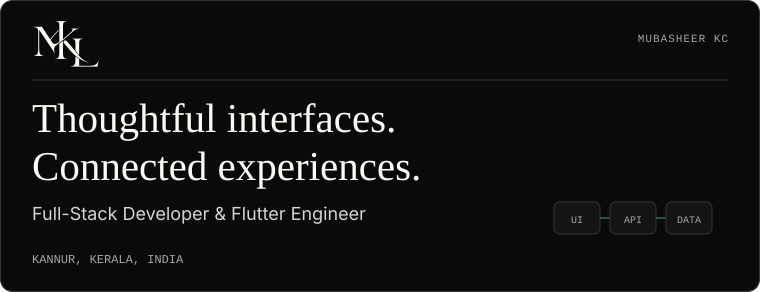
</picture>

  <a href="https://mubashir-portfolio-orpin.vercel.app">
    <picture>
      <source media="(max-width: 600px)" srcset="./assets/cta/visit-portfolio-mobile.svg" />
      
    </picture>
  </a>

  <a href="#selected-work">
    <picture>
      <source media="(max-width: 600px)" srcset="./assets/cta/explore-work-mobile.svg" />
      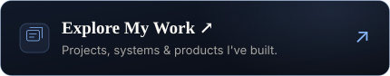
    </picture>
  </a>
  &nbsp;
  <a href="#contact">
    <picture>
      <source media="(max-width: 600px)" srcset="./assets/cta/chat-with-me-mobile.svg" />
      
    </picture>
  </a>

<h2><picture><source media="(max-width: 600px)" srcset="./assets/ui/section-01-mobile.svg" />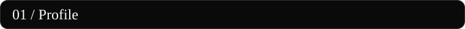</picture></h2>

I'm **Mubasheer KC**, a full-stack developer and Flutter engineer based in Kannur, Kerala, India. I build web applications, mobile experiences and the backend services that connect them. I care about clear interfaces, well-structured application logic and useful details.

<picture>
  <source media="(max-width: 600px)" srcset="./assets/ui/profile-signal-mobile.svg" />
  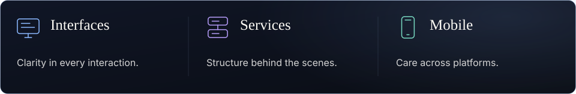
</picture>

<h2><picture><source media="(max-width: 600px)" srcset="./assets/ui/section-02-mobile.svg" />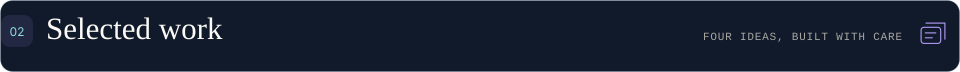</picture></h2>

Four projects across personal finance, developer education, service discovery and productivity. Each repository documents its own setup and scope.

<a href="https://github.com/Mubashir-114/fintrack_app">
  <picture>
    <source media="(max-width: 600px)" srcset="./assets/projects/fintrack-mobile.svg" />
    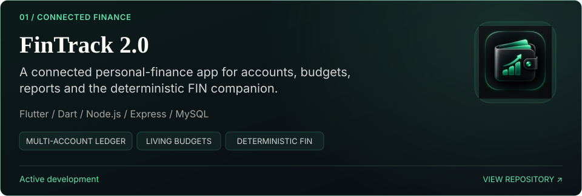
  </picture>
</a>

**Implemented:** accounts, transactions, budgets, reports, SMS review and the deterministic FIN companion. **Active development;** live currency conversion is planned.

   &nbsp;
   &nbsp;
  

<a href="https://github.com/Mubashir-114/kodehax_academy">
  <picture>
    <source media="(max-width: 600px)" srcset="./assets/projects/kodehax-mobile.svg" />
    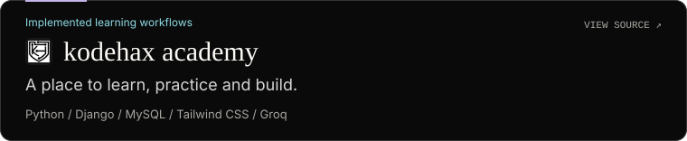
  </picture>
</a>

**Implemented:** student and teacher workflows, classrooms, coding challenges, assessments and Groq-assisted tutoring. AI features require a configured Groq service; further analytics and mobile coverage remain on the roadmap.

   &nbsp;
  

<a href="https://github.com/Mubashir-114/Provia">
  <picture>
    <source media="(max-width: 600px)" srcset="./assets/projects/provia-mobile.svg" />
    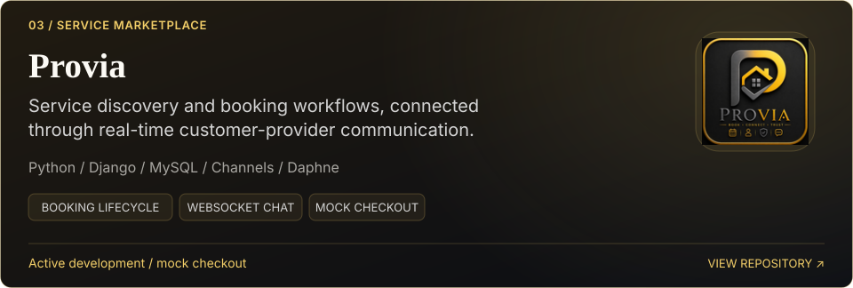
  </picture>
</a>

**Implemented:** service discovery, booking workflows and customer-provider WebSocket chat. **Active development; checkout simulates payments** and does not demonstrate live payment processing.

   &nbsp;
  

<a href="https://github.com/Mubashir-114/Nexo-frontend">
  <picture>
    <source media="(max-width: 600px)" srcset="./assets/projects/nexo-mobile.svg" />
    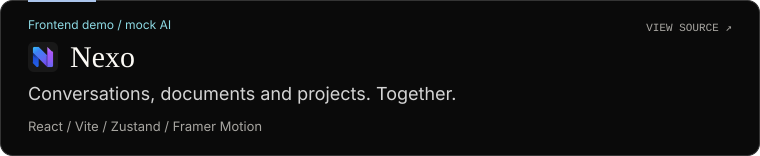
  </picture>
</a>

**Frontend demonstration:** conversations, documents, projects and workspace search using domain-specific Zustand stores. AI responses and retrieval are mocked; no live model is connected.

   &nbsp;
  

<h2><picture><source media="(max-width: 600px)" srcset="./assets/ui/section-03-mobile.svg" />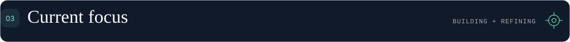</picture></h2>

<picture>
  <source media="(max-width: 600px)" srcset="./assets/ui/now-mobile.svg" />
  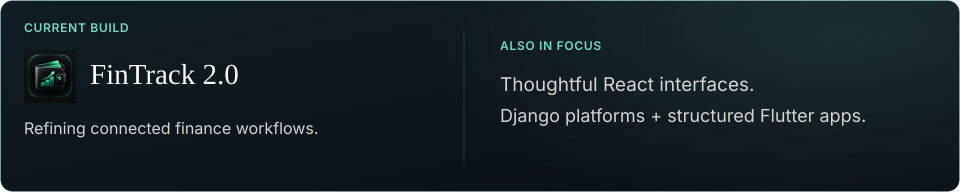
</picture>

<h2><picture><source media="(max-width: 600px)" srcset="./assets/ui/section-04-mobile.svg" />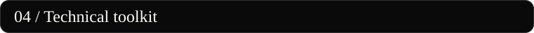</picture></h2>

<picture>
  <source media="(max-width: 600px)" srcset="./assets/ui/toolkit-mobile.svg" />
  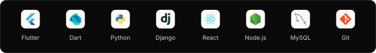
</picture>

<h2><picture><source media="(max-width: 600px)" srcset="./assets/ui/section-05-mobile.svg" /></picture></h2>

<a href="https://github.com/Mubashir-114?tab=overview">
  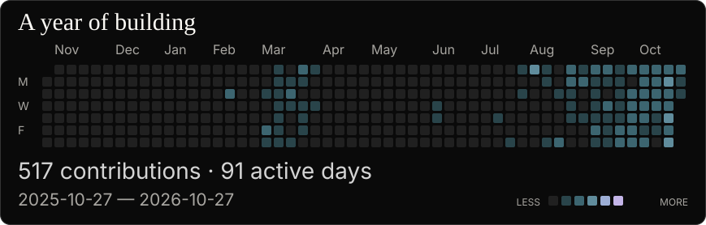
</a>

Generated daily from the GitHub contribution calendar available to the workflow token. The displayed date range identifies the snapshot. [View contribution history](https://github.com/Mubashir-114?tab=overview) · [Refresh workflow](https://github.com/Mubashir-114/Mubashir-114/actions/workflows/update-profile-activity.yml)

<h2><picture><source media="(max-width: 600px)" srcset="./assets/ui/section-06-mobile.svg" /></picture></h2>

Have a concrete problem or an idea worth building? I'm interested in thoughtful web products, Flutter applications and connected backend systems.

  <a href="mailto:mklmubashir575@gmail.com">
    <picture>
      <source media="(max-width: 600px)" srcset="./assets/ui/contact-email-mobile.svg" />
      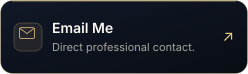
    </picture>
  </a>
  &nbsp;
  <a href="https://www.linkedin.com/in/mubashir-kc-b630b73a4">
    <picture>
      <source media="(max-width: 600px)" srcset="./assets/ui/contact-linkedin-mobile.svg" />
      
    </picture>
  </a>
  &nbsp;
  <a href="https://mubashir-portfolio-orpin.vercel.app">
    <picture>
      <source media="(max-width: 600px)" srcset="./assets/ui/contact-portfolio-mobile.svg" />
      
    </picture>
  </a>

<picture>
  <source media="(max-width: 600px)" srcset="./assets/footer-mobile.svg" />
  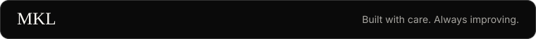
</picture>
